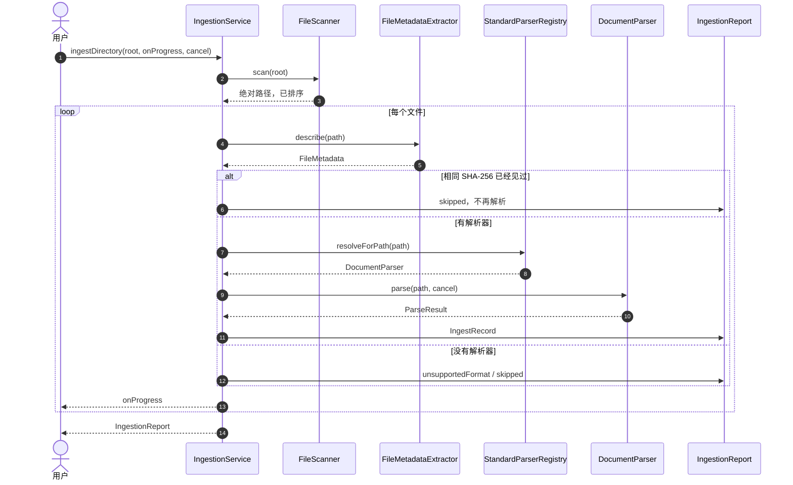
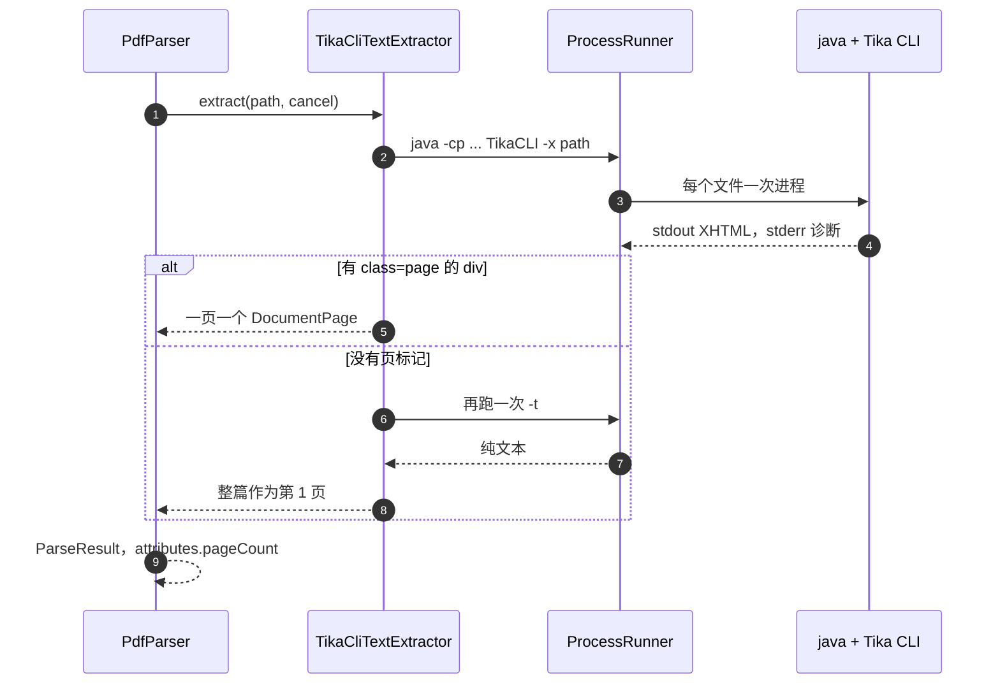

# 技术设计文档（TDD）

**Offline Accessible Multimodal Local Content Retrieval System**
---

## 1. 数据流

用户选一个目录。`IngestionService` 扫描白名单文件，为每个文件做元数据，再按扩展名解析。成功或失败都变成一条 `IngestRecord`。W3 只消费 `indexable`，不重新读盘。



PDF 是唯一在 W2 启动外部进程的格式。DOCX、TXT、JPEG、PNG 都在 Dart 里完成。



`-x` 的 stdout 里没有 page div 时再跑 `-t`。这包括 `-x` 退出码非 0、但正文里没有页。超时和 Java 启动失败会直接抛出，不再跑 `-t`。两次都失败时抛 `TextExtractionException`，stderr 留在异常里，不进正文。`PdfParser` 把启动失败记成 `dependencyUnavailable`，把超时记成 `timeout`，把提取异常记成 `corruptedInput`，都是 `failed`。同批其他文件继续。

## 2. 解析层

包是 `packages/core_parsing`，公开入口是 `lib/core_parsing.dart`。桌面应用用 path 依赖引用它，界面代码不读文件。

| 格式 | 实现 | 失败时 |
|---|---|---|
| TXT | `TxtParser`。UTF-8、UTF-8 BOM、UTF-16 LE/BE，否则 GBK。换行收成 `\n` | 超过 10 MB 为 `partial`。GBK 兜底写 warning。缺失文件为 `failed` |
| DOCX | `DocxParser` 解 `word/document.xml`。`w:tab` / `w:br` 保留。core.xml 有值才写 title、creator、created | 坏 zip 或缺少 document.xml 为 `corruptedInput`。没有 core.xml 时正文仍成功 |
| PDF | `PdfParser` 只依赖 `TextExtractor`。W2 的实现是 `TikaCliTextExtractor` | 缺 Java、超时、Tika 非 0 退出分别是 `dependencyUnavailable`、`timeout`、`corruptedInput` |
| JPG / PNG | `ImageParser` 读尺寸和格式，正文为空，不 OCR | 空文件或伪装扩展名为 `corruptedInput` |

扩展名分派只在 `StandardParserRegistry`。未知扩展名不抛异常。新增一种格式要加一个解析器类，并在构造注册表时多传一个实例。

扫描跳过点开头的名字、`~$` 临时文件和两个系统目录，不跟随符号链接。元数据里的 `createdAt` 使用 `stat.changed`。相同 SHA-256 的第二个文件跳过解析。默认两个文件并行，执行器仍是当前 isolate 上的 `ImmediateExecutor`。

坏根目录不让调用方崩溃：不存在或不是目录记一条 `failed`，列目录时权限不足记一条 `skipped`。

## 3. 单文件耗时

 `reports/week2/logs/day3_jvm_single_file.txt`，命令是 `parse_probe.dart --path datasets/samples`。毫秒数是解析器自己的 `ParseResult.duration`，PDF 那一条包含一次 JVM 启动。

| 文件 | 路径 | 耗时 | 结果 |
|---|---|---|---|
| sample.docx | 纯 Dart | 73 ms | ok，1 页，1499 字符 |
| sample.pdf | Tika CLI，一次 JVM | 4857 ms | ok，2 页，4358 字符 |
| sample.png | 纯 Dart | 75 ms | ok，1186×1137，png / rgb |

Day 4 对同一目录又跑了一次探针，原始输出在 `reports/week2/logs/ingest_samples.txt`：docx 80 ms，pdf 5215 ms，png 80 ms。同一份日志里，50 张 coco JPEG 为 1400 ms，16 张 rvlcdip PNG 为 651 ms。这两批不启动 JVM。

因此 W2 保持「每个 PDF 一次进程」。常驻 JVM 或 PDFium 当时留到 Q1 / Q6，不在 W2 改接口。Q1 与 Q7 已在 2026-10-15 结案，见 §4。页边界仍以 Tika `-x` 的 page div 为准。

2026-10-10 对同一份 `datasets/samples/sample.pdf` 连跑 3 次。命令是 `parse_probe.dart --path datasets/samples/sample.pdf`，原始输出在 `reports/week3/logs/pdf_stage_timing.txt`。Java 17.0.4。三次都是 ok，2 页，4358 字符，71250 字节。`total_ms` 依次是 5101、4858、5137，中位数 5101。

| 阶段 | 第 1 次 | 第 2 次 | 第 3 次 | 最小 | 中位 | 最大 |
|---|---:|---:|---:|---:|---:|---:|
| `stat` | 1 | 2 | 2 | 1 | 2 | 2 |
| `process_start` | 40 | 39 | 47 | 39 | 40 | 47 |
| `process_wait` | 5050 | 4804 | 5076 | 4804 | 5050 | 5076 |
| `stream_drain` | 0 | 0 | 0 | 0 | 0 | 0 |
| `xhtml_split` | 3 | 4 | 3 | 3 | 3 | 4 |
| `text_fallback` | 0 | 0 | 0 | 0 | 0 | 0 |
| `assemble` | 1 | 2 | 1 | 1 | 1 | 2 |
| `total_ms` | 5101 | 4858 | 5137 | 4858 | 5101 | 5137 |

`stat` 是读取文件信息并判断是不是空文件。`process_start` 是创建 Java 进程。`process_wait` 从进程已启动到退出，含 JVM 启动、扫描 classpath 和 Tika `-x`。`stream_drain` 是收完 stdout 和 stderr。`xhtml_split` 是按页切开。`text_fallback` 为 0，因为 `-x` 已经分出 2 页。`assemble` 是拼出解析结果。三次的各段之和分别是 5095、4851、5129，比 `total_ms` 少 6 到 8 ms。`process_wait` 三次都约占 `total_ms` 的 99%，其中 JVM 启动和正文抽取还没有分开。上面 Day 3 的 4857 ms 与 Day 4 的 5215 ms 仍是当时的总时间。

## 4. 未决问题

Owner 一列是负责在对应周次做决定的角色，不是已经派给某个后续提交的任务编号。Q1、Q3、Q7 已于 2026-10-15 结案。Q2、Q5 已于 2026-10-20 结案。结论写在表下。Q4、Q6 仍未决，W4 只登记影响。

| 编号 | 问题 | 结论或倾向 | Owner | 状态 |
|---|---|---|---|---|
| Q1 | ORT/PDFium 是否都能拿到可信的预编译产物？拿不到怎么办 | 结案：不落地 PDFium，继续 Tika。见下文 | Week 3 | 已结案 |
| Q2 | `engine/`（Python + Chroma）是否进入发布包 | 结案：不进入。Chroma 只做评测对照，产品存储是 Dart + 系统 SQLite。见下文与 ADR 0004 | Week 4 | 已结案 |
| Q3 | 长文档切块策略（按页 / 按段 / 按 token 窗口） | 结案：页定位、段落切分、超长才切窗口。见下文与 ADR 0003 | Week 3 | 已结案 |
| Q4 | 扫描件（RVL-CDIP）是否引入 OCR | 先走图像向量，基准不达标再加。W2 只登记图像元数据 | Week 2 架构 | W6 |
| Q5 | 图像-only 文档如何在结果列表里排序与展示 | 结案：`clipShared` 单独召回，经 RRF 与文本同榜。见下文与 ADR 0004 | Week 4 | 已结案 |
| Q6 | 批量解析是否需要 worker isolate | PDF 单文件 4857 ms，见 `reports/week2/logs/day3_jvm_single_file.txt`。W2 仍用 `ImmediateExecutor` | Week 2 架构 | W6 |
| Q7 | PDF 页码策略会不会随 PDFium 改变 | 结案：W3 不换 PDFium，页码继续以 Tika `-x` 的 page div 为准 | Week 3 | 已结案 |

### Q1 结案（2026-10-15）

不实现 `PdfiumTextExtractor`。PDF 文本继续走 ADR 0002 的 `TikaCliTextExtractor`。

判据是 `reports/week3/logs/pdf_stage_timing.txt`。2026-10-10 对 `datasets/samples/sample.pdf` 连跑 3 次，Java 17.0.4，三次都是 ok、2 页、4358 字符。`total_ms` 为 5101、4858、5137，中位 **5101**。`process_wait` 为 5050、4804、5076，中位 **5050**，约占 `total_ms` 的 **99%**。这一段包含 JVM 启动、classpath 扫描和 Tika `-x`，三者还没有拆开。

对照 ADR 0002 的触发条件：

- **T1 不满足**。`native/pdfium/windows/` 里没有可信来源的 `pdfium.dll`，也没有可用的 FFI 绑定。
- **T2 视为满足**。单文件总时间高于 2 s，而且 `process_wait` 占了约 99%。换掉每文件一次 JVM 能改善的是吞吐，不是抽取正确性。W3 的交付物是向量，不是 PDF 解析器。吞吐留到 W6，不在本周改解析实现。

ONNX Runtime 已装在 `engine/.venv`（1.30.0），本周只用它跑 embedding 探针。它不是 PDF 文本的预编译替代品，也不改变 `TextExtractor` 这条缝。

### Q3 结案（2026-10-15）

切块策略冻结为：**页面用于定位，段落用于切分，长度上限才切窗口。** 实现是后续的 `TextChunker`，规则写在 ADR 0003。这里只记结论。

防御性级联，不能假定每种格式都有段落：

```text
\n\n → \n → 句末标点（。！？；. ! ? ;） → 硬窗口
```

依据是 W2 解析器的实际输出。TXT 保留 `\n\n`。DOCX 把段落和段内换行都写成 `\n`，两者分不开；W3 接受按单换行切，不改已经冻结的 `ParsedDocument`。PDF 的 Tika `-x` 文本没有段落契约。

偏移量单位是 **UTF-16 code unit**，与 `DocumentPage.charCount`（`String.length`）相同。`startOffset` 含首，`endOffset` 不含尾。高亮、切片、引用共用这一单位。

`chunkId` 由内容哈希、分块器版本、页码和块序号组成。只有同一内容哈希、同一分块器版本、同一配置才可复现。文档或参数变了，编号就变。W4 不把它当主键；能否复用改看五项代次键，见 ADR 0004 决策 4。

跨页合并不做。`sample.pdf` 两页共 4358 字符，大约 2179 字符一页；检索用的块比一页短得多，所以「答案跨页」实际上是「答案跨过相邻块」。W3 保证 `pageNumber` 和偏移被留下来。**跨页答案的邻域扩展由 W4 承接。** 证据集里的跨页题，通过标准也定在 W4。

证据集已在 2026-10-16T13:12:33Z 冻结：`reports/week3/evidence_set.jsonl`，25 条，dev 15 / holdout 10，说明见 `reports/week3/证据集说明.md`。其中 `ev-08`、`ev-16`、`ev-17` 的证据在 PDF 两页都有完整落点。抽出的两页是同一篇说明的重复排版，没有一句从页末续到下一页。W3 没有用这个集子算出检索分数，也没有回头改切块参数。

字符长度用来切块，token 长度用来校验。超长必须重切或显式记 warning，不静默截断。`chunkChars` 的初值跟所选模型和语料走，不宣称某一组数字普遍最优。文本模型的运行上限是 128 个 token，见 `models/README.md`。

### Q2 结案（2026-10-20）

`engine/` 不进入发布包。Python 和 Chroma 只留在开发期评测。产品索引是 Dart 包 `packages/core_storage`：系统 SQLite，向量用 fp32 小端 BLOB，余弦用点积。

Chroma 没有被丢掉。`chromadb 1.5.9` 用同一批向量建集合，集合度量必须是 `hnsw:space=cosine`，再和 Dart+SQLite 比 Top-5。一致率的出口是不低于 96%。2026-10-20 实测 121/125（96.8%），原始输出在 `week4/logs/storage_equivalence.txt`。4 处不一致都是第 5 名，落在 `sample.pdf` 两页重复排版上。Dart 侧的 `chromadb` HTTP 客户端要第二个进程，和「不把 `engine/` 打进安装包」冲突，所以不进产品运行时。

依据是本机探针，不是容量估算：SQLite 3.53.4 的 FTS5 / WAL 可用（`week4/probes/probe_sqlite_capacity.txt`、`week4/probes/dart_store_probe.txt`）。`winsqlite3.dll` 的用法未写入系统文档，W8 再决定公开包是否改带自己的 `sqlite3.dll`。动态库通过 `SqliteLibraryLocator` 注入，路径不写死。

### Q4 登记（2026-10-20，未结案）

扫描件本周仍不引入 OCR。图像文件走 `clipShared`，和 Q5 的同榜规则一起检索。RVL-CDIP 的标注和 OCR 继续留到 W6。本周没有新的扫描件基准。

### Q5 结案（2026-10-20）

图像文档和文本文档上同一张结果榜。图像向量只在 `clipShared` 里召回，文本向量只在 `documentText` 里召回，两路不交叉算余弦。名次用 RRF 合并，`k=60`，图像路权重初值 0.2。图像路没有命中不是失败。

结果携带 `modality`。图像行携带 `imageAsset`（格式、宽、高），界面用它做缩略图和尺寸，不另算一遍分数。`pageNumber == null` 的规则不变，图像行也不显示假页码。

混合榜的臂是评测里的 A2 和 A4。那张表在精度基准里出数，不在本条结案里预写一个 Hit@5。

### Q6 登记（2026-10-20，未结案）

批量解析本周仍用 `ImmediateExecutor`，不把解析放进 worker isolate。常驻嵌入进程把大约 1454 块的前向从几十分钟降到大约 37 秒（`week4/probes/probe_persistent_runtime.txt` 的 25.5 ms/条）。PDF 仍是每个文件一次 JVM，`process_wait` 占单文件时间的大约 99%。isolate 有没有收益，等 W6 用这条计时基线再量。

### Q7 结案（2026-10-15）

页码策略不随 PDFium 改变，因为 Q1 决定 W3 不换 PDFium。

W2 的规则继续有效：有 Tika `-x` 的 `<div class="page">` 就按它分页，没有则整篇一页。TXT 和 DOCX 没有物理页，`TextChunk.pageNumber` 为 null，界面不得把它显示成真实页码。以后如果真的换抽取器，新实现仍要填 `DocumentPage`，不能让页码语义跟着实现漂。
