# W04 报告

---

## 1. 测试范围与环境

本文核对本地向量库、三路召回、端到端探针，以及五个 Dart 包的默认单测覆盖率。默认套件排除 `integration`，不加载模型和数据集。冻结的 25 条证据集没有改。

环境见 `logs/env_w4.txt`：

- Dart 3.13.4（stable）
- Java 17.0.4
- Python 3.13.2（`engine/.venv`）
- `C:\Windows\System32\winsqlite3.dll` 存在。容量探针读到 SQLite 3.53.4，WAL
- chromadb 1.5.9，见 `logs/chroma_baseline.txt`
- `datasets/samples/sample.pdf`、`sample.docx`、`sample.png` 和 COCO 披萨图都在

判定以日志里的退出码、计数和耗时为准。终端截屏在第 5 节，路径相对本报告。若干 `e2e_*.txt` 的 `query=` 行是 PowerShell 把 Dart 的 UTF-8 输出按系统代码页解开的，命令注释行仍是原来的中文问句。

机器网络没有关掉。离线检查是三个 `lib/` 的 grep，见 E2E 表最后一行。

## 2. 用例表

| 用例 ID | 命令 | 期望 | 实际 | 判定 | 证据 |
|---|---|---|---|---|---|
| ANA-01 | 三个新包各自 `dart analyze` | 0 issue | 三个包都是 `No issues found!`，退出码 0 | 通过 | `logs/dart_analyze.txt`；`screenshots/ANA-01-dart-analyze.png` |
| UNIT-01 | 三包 `dart test --exclude-tags integration` | 默认套件全绿 | 存储 `00:02 +14`，检索 `00:02 +8`，编排 `00:03 +23` | 通过 | `logs/coverage.txt` |
| COV-01 | 五包 `--coverage` 后 `--report-on=lib` | 新三包 ≥ 85%；解析不低于 80%；嵌入不低于 85% | 存储 488/573 = 85.17%，检索 158/164 = 96.34%，编排 280/298 = 93.96%，解析 979/1091 = 89.73%，嵌入 1250/1458 = 85.73% | 通过 | `覆盖率报告.md`；`coverage/*.lcov.info`；`screenshots/COV-01-coverage.png` |
| H1 | 已有的 Chroma 与 Dart Top-5 对照 | 125 个位置一致率 ≥ 96% | `agreed=121`，`agreement=0.968000`，`passed=1`。四处都是第 5 名，`sample.pdf` 两页重复块，分数差最多 3.9e-7 | 通过 | `logs/storage_equivalence.txt`；`screenshots/H1-storage-equivalence.png` |
| CAP-01 | `packages/core_storage/bin/capacity_probe.dart` 写 1 万条 | ≤ 600 ms | `write_ms=576`。SQLite 3.53.4，WAL | 通过 | `logs/storage_capacity.txt`；`screenshots/CAP-02-query-104ms.png` |
| CAP-02 | 同上，384 维查询中位 | ≤ 60 ms | 中位 104 ms，最小 87，最大 105。`EXPLAIN` 走 `idx_chunk_space`。门槛未改 | 未通过 | `logs/storage_capacity.txt`；`screenshots/CAP-02-query-104ms.png` |
| CHR-01 | `engine/chroma_baseline.py` | 记下 chromadb 版本、Hit@5、MRR@10。这是导出向量上的对照，不是产品检索器 | chromadb 1.5.9，`hnsw:space=cosine`。Hit@5 0.880000 [0.700442, 0.958332] (22/25)，MRR@10 0.795714。对 numpy 125/125 | 通过 | `logs/chroma_baseline.txt`；`screenshots/CHR-01-chroma-baseline.png` |
| E2E-01 | `index_probe` 建 `week4/.index/evidence.sqlite` | 样本和 COCO 小样入库 | 样本 3/3，97 块，12045 ms。COCO 50/50，50 块，7048 ms。合计 147 块、53 个文档，`index_ms_total=19093`。`keyword_terms=0` | 通过 | `logs/e2e_build.txt`；`logs/e2e_samples.txt`；`screenshots/E2E-01-build.png` |
| E2E-02 | 同一库再跑一次 `index_probe` | 内容未改则全部复用 | 样本 `reused=3`，COCO `reused=50`，`written=0`。统计仍是 147/53。`index_ms_total=6873` | 通过 | `logs/e2e_rebuild.txt`；`screenshots/E2E-02-rebuild.png` |
| E2E-03 | 临时目录三份 Markdown，改 `a.md` 后再索引 | 未改的文件复用；改过的文件替换旧行，文档数不增加 | 第一次 3 个文档、378 块、16130 ms。追加一句后 `written=1`，`reused=2`，85 块，5117 ms。`stats_documents=3`，`stats_chunks=379` | 通过 | `logs/e2e_incremental.txt`；`screenshots/E2E-03-incremental.png` |
| E2E-04 / H3 | `search_probe --top 10 --query "工具靠什么判断文件类型？"` | 问句不含文件名。Top-5 出现目标文件，并给出页和偏移。原文件在磁盘上 | Top-10 都是文本。`sample.pdf` 在第 1、2、4、5 名，`sample.docx` 在第 3 名。第 4 名 `page=1`，`start=617`，`end=710`，片段含 `missing or misleading extension`（证据跨度 679–710 落在这块内）。两个目标文件都存在 | 通过 | `logs/e2e_query.txt`；`logs/env_w4.txt`；`screenshots/E2E-04-h3-query.png` |
| E2E-05 | 同一进程第二条问句「这份说明在能够被完全信任之前，还要求人做什么？」 | 再出一份带出处的 Top-K | 第 1 名 `sample.pdf`，`page=1`，`start=160`，`end=253`，片段含 `requires human review`。`encode_ms=67` | 通过 | `logs/e2e_query.txt`；`screenshots/E2E-05-second-query.png` |
| E2E-06 | `--extension .pdf`、`--path-prefix sample.pdf`、`--modified-after` | 扩展名和路径只留 pdf；过去的时间仍有命中；2099 年之后为 0 | `.pdf` 与 `sample.pdf` 的前几名都是 `sample.pdf`。`2020-01-01` 的第 3 名仍是 `sample.docx`。`2099-01-01` 为 `hits=0` | 通过 | `logs/e2e_filters.txt`；`screenshots/E2E-06-filters.png` |
| E2E-07 | 问「哪张图里有人在厨房做披萨？」，以及 `--extension .jpg` | Top-5 出现 `000000397133.jpg` | 不限类型时 Top-10 全是 `sample.pdf` / `sample.docx`。只留 `.jpg` 时五条都是图，第 1 名是 `000000403385.jpg`，披萨图不在这五条里 | 未通过 | `logs/e2e_query.txt`；`logs/e2e_filters.txt`；`screenshots/E2E-07-image.png` |
| E2E-08 | 同一问句比较 `--arm A5` 与 `--arm A4` | 邻域不改名次和偏移；A5 的片段带上相邻块 | 两边第 4 名都是 `score=0.007813`，`page=1`，`start=617`，`end=710`。A5 片段多出前一块的 `interface, making Tika useful` | 通过 | `logs/e2e_neighborhood.txt`；`screenshots/E2E-08-neighborhood.png` |
| E2E-09 | `index_probe --cancel-after 1`，目录里 a.txt、b.txt、c.txt | 已写入的文件留下，后面的文件不写 | `written=1`，`cancelled=true`，`stats_documents=1`。检索命中 `a.txt`。问第二句仍返回这一行，因为库里只有一行，且没有分数下限 | 通过 | `logs/e2e_cancel.txt`；`screenshots/E2E-09-cancel.png` |
| E2E-10 | 目录里一份好 txt 和一份坏 docx | 坏文件记失败，好文件仍入库，整批退出码 0 | `ingest_failed=1`，`written=1`，报告 `failed=0`。检索命中 `good.txt` | 通过 | `logs/e2e_cancel.txt`；`screenshots/E2E-10-bad-file.png` |
| E2E-11 | 空库上 `search_probe` | `hits=0` | 清库前的空库查询 `hits=0` | 通过 | `logs/e2e_clear.txt`；`screenshots/E2E-11-empty.png` |
| E2E-12 | 写入后再 `--clear`，然后查询 | 块数从 1 到 0，查询为空 | `clear_before_chunks=1`，`clear_after_chunks=0`，随后 `hits=0` | 通过 | `logs/e2e_clear.txt`；`screenshots/E2E-12-clear.png` |
| DOC-01 | `index_probe --path docs` 两次，再搜「产品侧用系统 SQLite 保存向量」 | 第一次写入，第二次复用。中文问句能命中 ADR | 9 个文件、2870 块，第一次 110092 ms，第二次 `reused=9`，5481 ms。`keyword_terms=14915`。第 1 名是 ADR 0004，`start=1304`，`end=1336`，通道 `documentText,keyword` | 通过 | `logs/e2e_docs.txt` |
| H2 | `eval_retrieval.py` 六臂 dev，然后 A4 holdout 一次 | 融合的 Hit@5 与 MRR@10 不低于任一单通道。没有增益就照实写，不改权重 | dev 上 A4 与 A1 同为 10/15、MRR 0.622222，高于 A0 和 A2。没有正增益。holdout A4 为 5/10。`parameters_changed_after_freeze=0`，holdout 只打了 1 次 | 通过（无正增益） | `检索精度基准报告.md`；`logs/retrieval_bench_dev.txt`；`logs/retrieval_bench_holdout.txt`；`screenshots/H2-dev.png`；`screenshots/H2-holdout.png` |
| OFF-01 | 三个新包 `lib/` 搜索 `HttpClient\|Socket\|import .http\|package:http` | 无匹配。不断开机器网络 | 扫描 40 个 dart 文件，`matches=0`，`network_disabled=0` | 通过 | `logs/offline_check.txt`；`screenshots/OFF-01-offline-grep.png` |

E2E-01 到 E2E-12 里，E2E-07 未通过，其余通过。CAP-02 未通过。

## 3. 交付物

| 编号 | 文件 | 状态 |
|---|---|---|
| G1 | `packages/core_storage/`、`packages/core_retrieval/` | 已完成。分析无问题，默认套件全绿，覆盖率 85.17% 与 96.34% |
| G2 | `packages/core_pipeline/bin/index_probe.dart`、`search_probe.dart` | 已完成。H3 通过，见 E2E-04 |
| G3 | 本报告、`week4/logs/`、`screenshots/` | 已完成。E2E-07 与 1 万块查询未过，其余用例通过。20 张终端截屏 |
| G4 | `week4/检索精度基准报告.md` | 已完成。六臂、Wilson 区间、逐题表、holdout 一次 |
| G5 | `week4/logs/storage_equivalence.txt` | 已完成。121/125，未重写 |
| G6 | `docs/architecture/adr/0004-vector-storage-and-fusion.md` | 已完成。融合后果已写上实测：不低于单通道，且没有正增益 |
| G7 | `docs/api/storage-module-api.md`、`docs/api/retrieval-module-api.md` | 已完成。存储文档写明 1 万块写入 576 ms、查询中位 104 ms |
| G8 | `week4/coverage/*.lcov.info`、`覆盖率报告.md` | 已完成。五个包都在门槛之上 |

`week4/evidence_set_w4.jsonl` 有 12 条，说明在 `证据集说明_w4.md`。它没有并入冻结集，也没有参加打分。

## 4. 证据索引

| 路径 | 对应内容 |
|---|---|
| `week4/logs/dart_analyze.txt` | ANA-01 |
| `week4/logs/coverage.txt` | UNIT-01、COV-01 的合计 |
| `week4/coverage/*.lcov.info` | COV-01 |
| `week4/logs/storage_equivalence.txt` | H1 |
| `week4/logs/storage_capacity.txt` | CAP-01、CAP-02 |
| `week4/logs/chroma_baseline.txt` | CHR-01 |
| `week4/logs/e2e_build.txt` | E2E-01 |
| `week4/logs/e2e_samples.txt` | E2E-01 的副本 |
| `week4/logs/e2e_rebuild.txt` | E2E-02 |
| `week4/logs/e2e_incremental.txt` | E2E-03 |
| `week4/logs/e2e_query.txt` | E2E-04、E2E-05、E2E-07 |
| `week4/logs/e2e_filters.txt` | E2E-06、E2E-07 的 jpg 过滤 |
| `week4/logs/e2e_neighborhood.txt` | E2E-08 |
| `week4/logs/e2e_cancel.txt` | E2E-09、E2E-10 |
| `week4/logs/e2e_clear.txt` | E2E-11、E2E-12 |
| `week4/logs/e2e_docs.txt` | DOC-01 |
| `week4/logs/retrieval_bench_dev.txt` | H2 的 dev |
| `week4/logs/retrieval_bench_holdout.txt` | H2 的 holdout |
| `week4/logs/offline_check.txt` | OFF-01 |
| `week4/logs/env_w4.txt` | 环境与目标文件是否存在 |
| `week4/检索精度基准报告.md` | G4 |
| `week4/覆盖率报告.md` | G8 |
| `week4/evidence_set_w4.jsonl` | 邻域核对，未打分 |
| `screenshots/*.png` | 第 2 节有截屏的用例 |

## 5. 截屏

按第 2 节的用例 ID 排列。UNIT-01 和 DOC-01 没有单独的终端截屏，证据仍是对应日志。CAP-01 与 CAP-02 共用一张图。

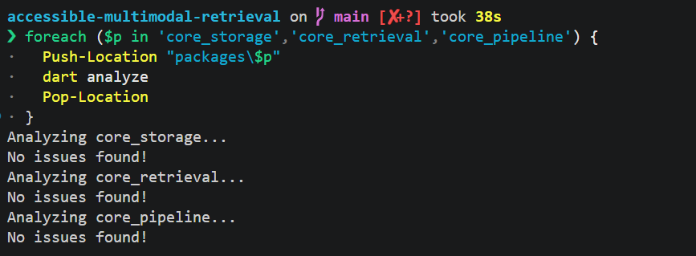

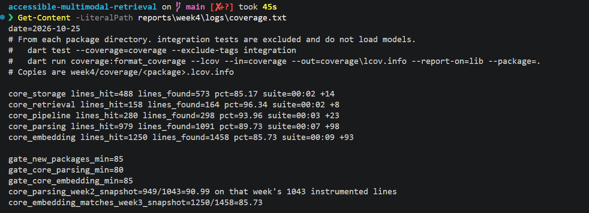

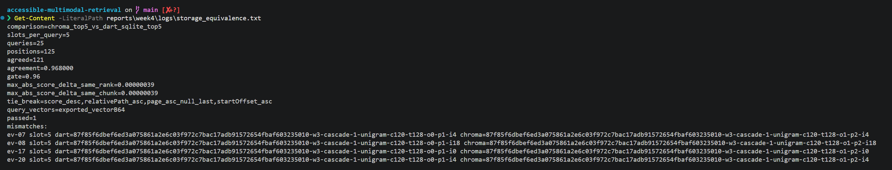

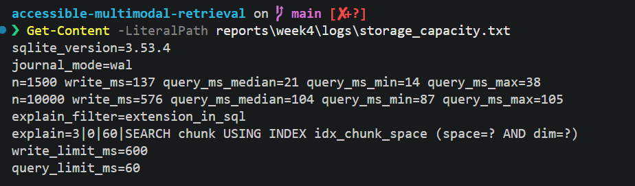

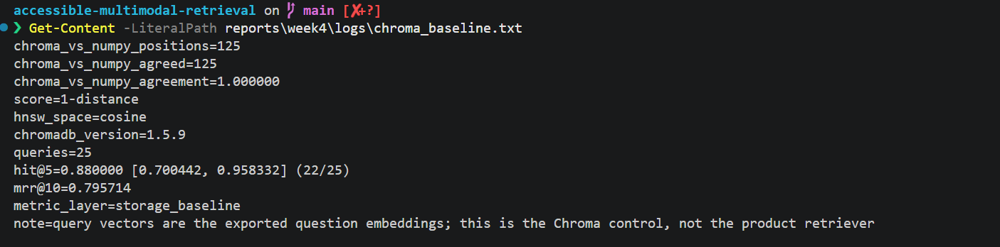

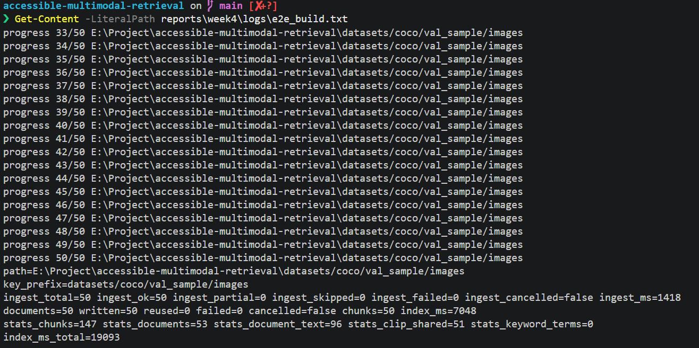

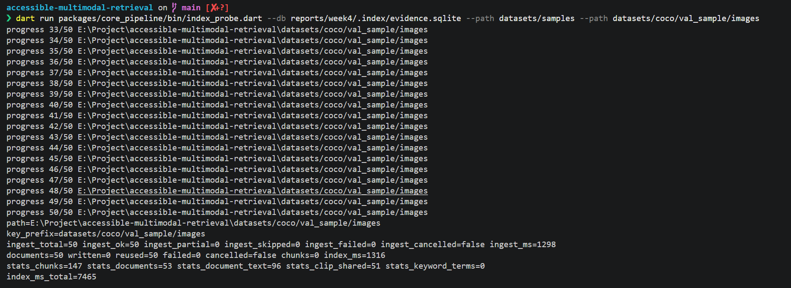

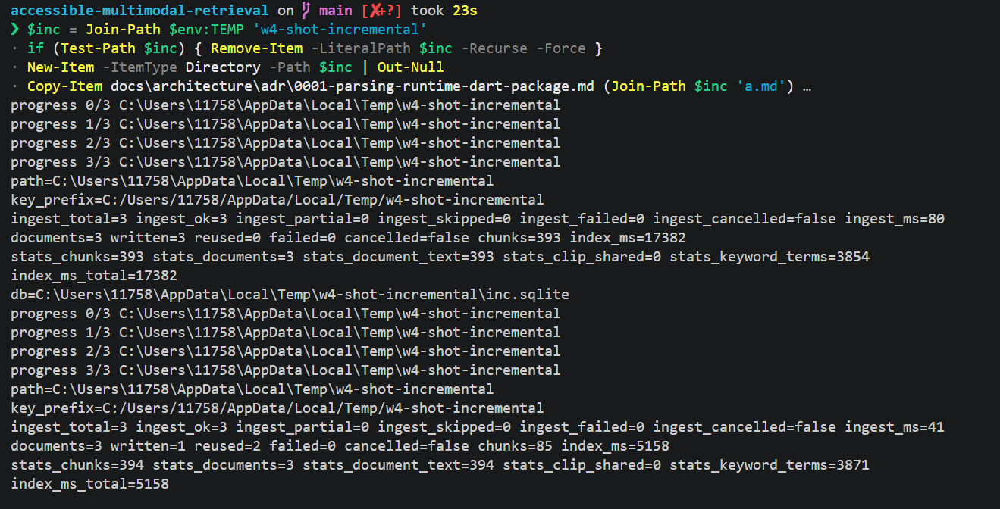

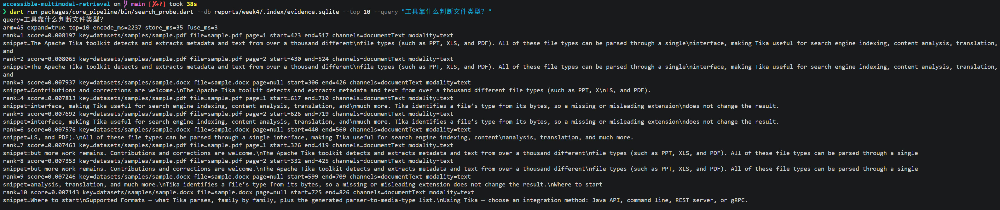

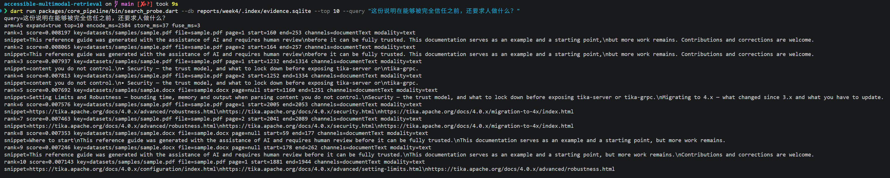

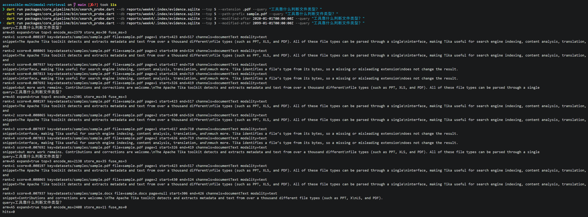

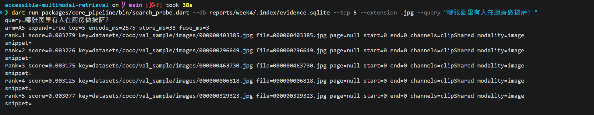

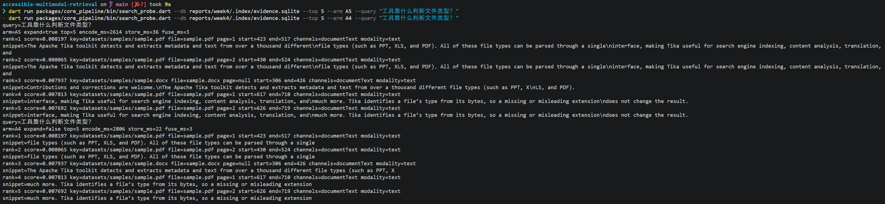

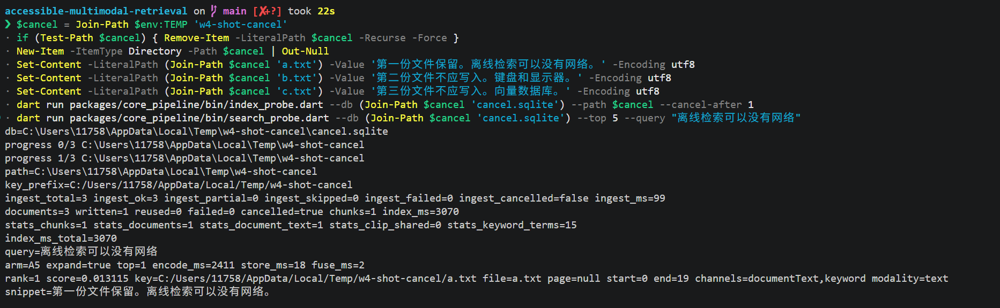

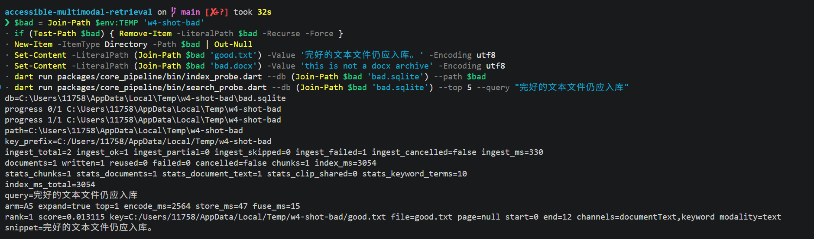

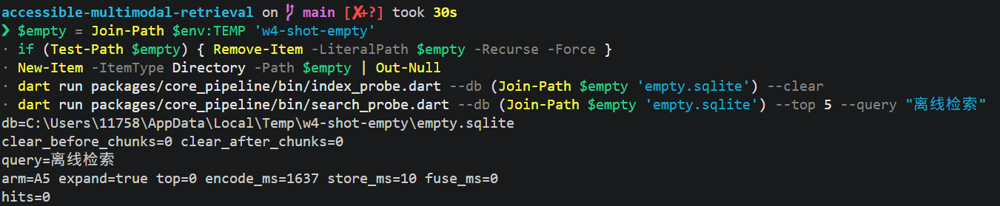

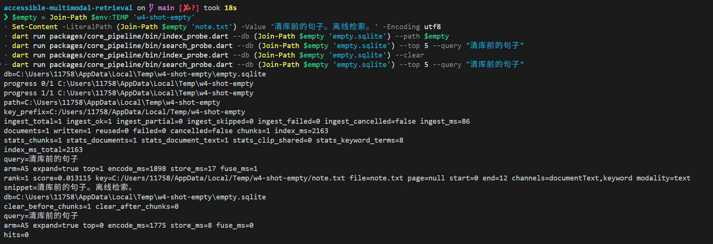

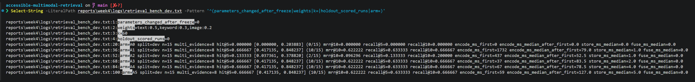

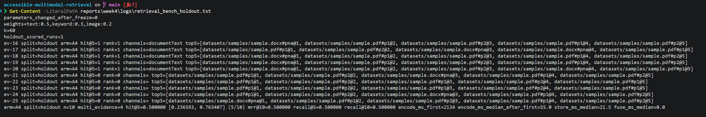

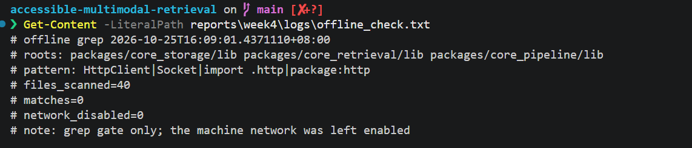

## 6. 自查

- H1 通过，日志保持 121/125。Chroma 对 numpy 的 125/125 写在 `chroma_baseline.txt`，没有覆盖 H1。
- H2 的「不低于」成立。融合相对文本单通道没有正增益，权重和 `k` 未改，holdout 只出了一次。
- H3 通过：中文问句的 Top-5 含两份目标文件，第 4 名给出页码和含证据句的偏移。
- 1 万块写入通过，查询中位 104 ms 未过 60 ms。
- 披萨图没有进融合 Top-10，也没有进 jpg 过滤后的 Top-5。
- 增量复跑后文档数仍是 3，块数 379，不再是改文件之前留下的 4 个文档、463 块。
- 覆盖率五包都在门槛上。嵌入与第 3 周的 1250/1458 相同。
- 三个 `lib/` 没有 `HttpClient`、`Socket` 或 `package:http`。没有为了这条检查断开网络。
