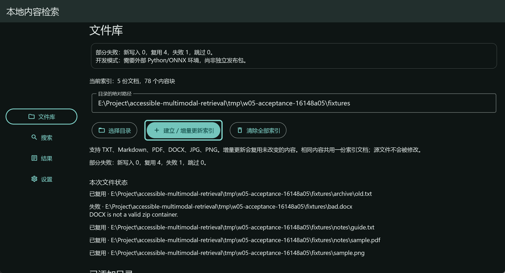
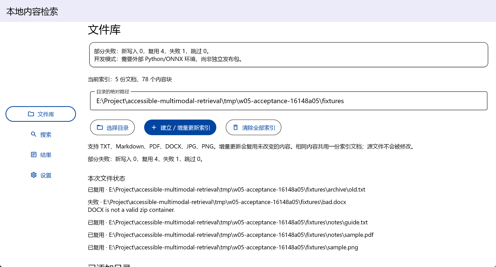
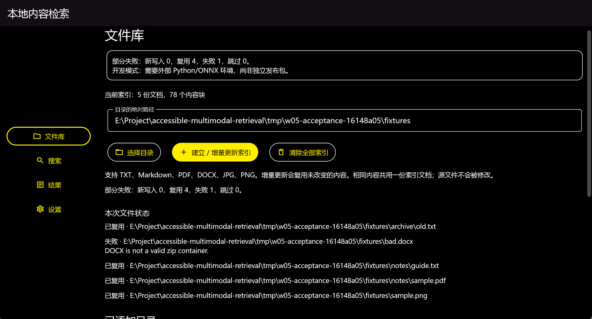
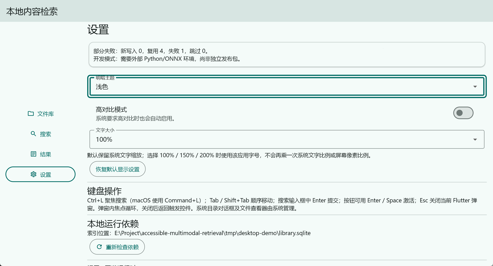
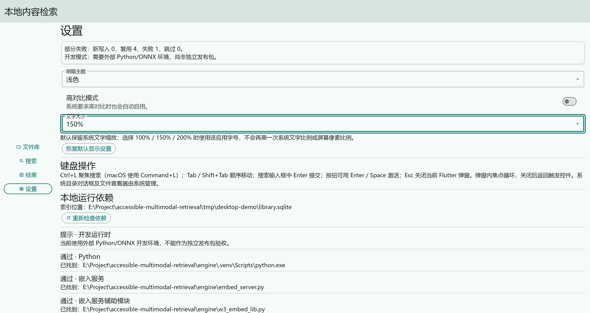
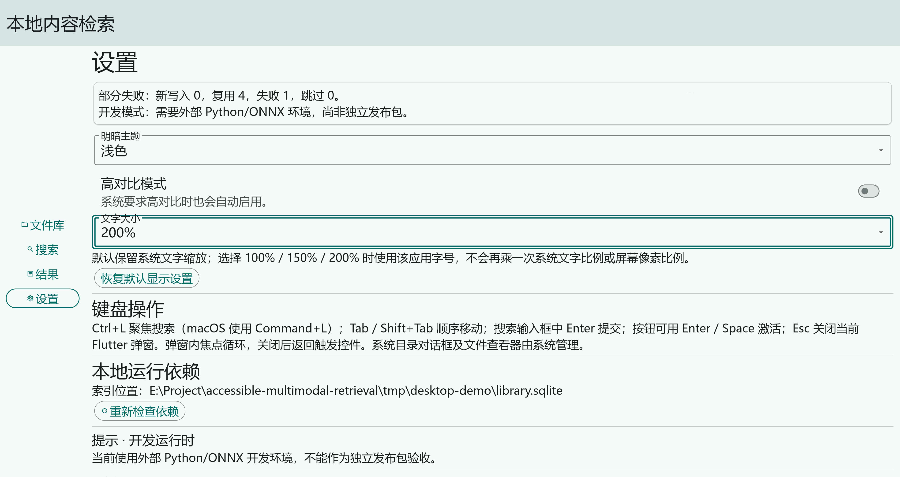

# 无障碍合规验证报告

## 1. 验证结论

当前 Windows 开发版本已实现键盘快捷操作、控件语义、可见焦点、状态提示、明暗高对比和应用字号设置。现有日志支持这些能力在自动测试覆盖范围内通过；用户保存的截图支持部分实际外观与焦点表现。

**当前结论为“部分验证，完整合规尚不能签收”，不宣称完整满足 WCAG 2.1 AA。** 已纳入 NVDA 2026.2.0.57664 的用户朗读记录和全程键盘操作确认；TXT 可用 Notepad 打开，错误恢复、索引/显示设置重启恢复及正文/来源路径可读已获用户确认。PDF 此前因 Acrobat 卡住未打开，后续用户确认已恢复；完整焦点闭环、动态播报、缩放组合及其他平台仍有缺口。本文是本次可交付的验证报告，不把文档完成等同于产品全部验收通过。

## 2. 范围、依据与判定方法

### 2.1 验证对象

范围包括文件库、搜索、结果、设置四个功能区，以及清空确认、索引进度、查询状态、输入错误和文件打开提示。依据 [W05 任务计划](W05_task_plan.md) 与 [E 验收矩阵](E_验收矩阵.md)。

WCAG 2.1 面向 Web 内容；本项目将其相关成功准则用作 Flutter 原生桌面界面的检查映射。本映射不是覆盖全部 A/AA 准则的正式符合性声明。其他准则的适用性、完整流程和辅助技术兼容性仍需后续评估。[WCAG 2.1 原文](https://www.w3.org/TR/WCAG21/)

### 2.2 判定口径

| 判定 | 含义 |
|---|---|
| 自动范围通过 | 相应自动用例或测量日志有成功结果，仅适用于该覆盖范围 |
| 图示支持 | 已查看截图，支持画面中可直接观察的内容，不能推断键盘操作历史或实际朗读 |
| 部分验证 | 已有实现及局部证据，但不足以签收整个准则或用户流程 |
| 未验证 | 缺少对应实测记录，不等于通过，也不等于已发现产品缺陷 |
| 当前目标不适用 | 工具或测试目标不匹配；保留原因，不伪造通过结果 |

本次进行代码、日志和静态截图核对，没有重新运行测试、启动读屏软件或重新操作桌面。

### 2.3 环境与构建追溯

| 项目 | 证据与范围 |
|---|---|
| 日志环境 | Windows 11 Pro 10.0 Build 26300；Dart 3.13.4；历史 E 环境记录 Flutter 3.47.5 |
| 最新真实集成记录 | `E_headless_acceptance.json`：2026-11-03 09:07:47—09:08:15（UTC+8），`ok=true` |
| 自动流程边界 | 同一记录明确 `desktopInteractions=false`、`nativeOpenMocked=true`、`screenReaderTested=false`、`networkIsolated=false` |
| 当前工作区实现 | 微软雅黑及中文本地化配置已在代码中；含未提交修改，不能只用 Git HEAD 代表全部文件 |
| 本次读取的 app.so | SHA256：`56ded88e9106dafcebae50a65631a8d2c91ad0e206a30f9559614910b68cdd47` |
| 历史构建清单 | `E_build_manifest.json` 的 app.so 哈希与上述哈希不同，不能把历史清单、当前工作区和全部截图当作同一已锁定构建 |
| 用户截图 | 当前 `screenshots/06`～`11` 文件；没有配套逐步操作、系统缩放和截图时二进制哈希记录 |

环境详情见 [E 环境记录](logs/E_environment.json)、[历史构建清单](logs/E_build_manifest.json)。后续实机复测应重新记录应用构建标识、OS、读屏版本、系统缩放、应用字号和实际按键。

## 3. 证据清单与自动检查结果

| 证据 | 本次读取的结果 | 不能据此推断的事项 |
|---|---|---|
| [F 常规测试日志](logs/F_flutter_test.txt) | 53 项通过、1 项跳过 | 跳过项不是已完成真实集成；不能推出实机读屏通过 |
| [F 真实集成测试日志](logs/F_flutter_test_real.txt) | 54 项通过，包含真实 worker、模型、SQLite 与设置 | 系统打开仍模拟，非独立用户试用 |
| [E 真实集成结果](logs/E_headless_acceptance.json) | `ok=true`，含导入、PDF/图片查询、输入修正、文件缺失、设置恢复、增量及清空检查 | 无桌面操作、无网络隔离、无实际读屏 |
| [D 对比度数据](logs/D_contrast.json) | 4 套明暗／高对比配置，共 28 个颜色对全部达到各自设定阈值 | 不是当前窗口像素扫描，不覆盖全部悬停、选中、合成和原生对话框状态 |
| [E 静态分析日志](logs/E_flutter_analyze.txt) | 历史记录无分析问题 | 不是本次对所有未提交更改重新运行分析 |
| 用户截图 06～11 | 支持局部焦点、明暗高对比外观及字号选项显示 | 不替代持续操作记录、语音记录或完整布局矩阵 |

自动用例源文件包括 [accessibility_test.dart](../../apps/desktop/test/accessibility_test.dart)、[library_test.dart](../../apps/desktop/test/library_test.dart)、[search_test.dart](../../apps/desktop/test/search_test.dart) 和 [acceptance_integration_test.dart](../../apps/desktop/test/acceptance_integration_test.dart)。

### 3.1 NVDA 用户实测与补充确认

证据：[NVDA 会话记录](logs/screen_reader_nvda_session.md)，补充归档日期 2026-11-03。NVDA 版本为 2026.2.0.57664，用户确认全程使用键盘。测试日期/起止、构建哈希、具体按键和系统显示条件未完整登记；不以历史构建哈希反填。原文中编辑器、输入法等切窗内容不计为检索应用的朗读或缺陷。

| 检查内容 | 可用结果与来源 | 判定范围 |
|---|---|---|
| 控件、查询与 PDF 筛选 | 原文有按钮/edit 角色、PDF 选项和第 1 页信息 | 局部实机读屏证据，非全部结构/状态签收 |
| 增量复用 | 原文有新写入 0、复用 4、失败 1 | 汇总可读，取消等流程仍未覆盖 |
| 正文片段、完整来源路径 | 用户补充确认可读 | 子项按用户确认通过，不补造逐字文本 |
| TXT 原文件 | 用户确认由 Notepad 打开 | TXT 打开子项通过；返回后的精确焦点未确认 |
| PDF 原文件 | 初次未打开；用户后续确认此前是 Acrobat 卡住，现已正常打开 | PDF 打开子项按用户确认通过；E-OPEN-01 作为查看器环境事件关闭，返回焦点另行验证 |
| 日期错误与恢复 | 原文有错误提示，用户确认修正后能重新搜索 | 该恢复子项通过；自动播报/主动阅读尚未区分 |
| 重启恢复 | 用户确认索引和显示设置恢复 | 恢复子项通过，具体值/数据目录和资源释放仍需追溯 |
| 设置与确认弹窗 | 原文有 checked、浅色/深色、200%、保留索引 focused 等信息 | 局部可读；未证明所有三档布局、默认焦点时机及完整循环/退出 |

**结论：Windows/NVDA 已有实机证据，整项部分验证。** 全程键盘的用户确认支持该次输入方式，但不代表所有任务均成功；PDF 初次失败与后续恢复均保留，当前已不作为未解决阻塞；其余未覆盖子项保留。实际朗读与自动 live region 播报分别判断，VoiceOver、独立试用和完整 WCAG 合规不由本次结果推断。

### 3.2 失败案例对用户操作的影响

- **E-INPUT-01 无效日期。** NVDA 记录可读取错误提示，用户确认修正后可继续搜索。程序将 `FormatException` 转为输入提示。补采堆栈记录了日期校验入口。
- **E-OPEN-01 Acrobat 无响应。** 初次 PDF 阅读受阻，TXT 可打开。用户后续确认 PDF 恢复，具体恢复操作及查看器堆栈未记录。返回应用后的焦点仍需单独验证。

完整分类和恢复证据见 [E 问题与复测记录](E_问题与复测记录.md)，本次补采见 [受控复现堆栈](logs/E_failure_reproduction_stack_traces.txt)。

### 3.3 对比度数据的解释

日志中按 4.5:1 阈值检查的文字颜色对最小值约 **6.16:1**，按 3:1 阈值检查的非文字颜色对最小值约 **4.28:1**，28 项没有低于各自阈值。WCAG 对普通文字与必要非文字视觉信息有相应对比度要求；禁用控件的适用性需要单独判断，不能将项目自设的禁用文字检查当作额外强制准则。[相关要求](https://www.w3.org/TR/WCAG21/#contrast-minimum)

上述结果保留为配置级证据。当前主题仍使用明确的文字、边框、焦点和错误颜色，但字体等工作区变更后尚未形成与当前构建完全绑定的全状态像素测量，故本报告不把配置测量扩大为整套界面全部通过。

## 4. 无障碍要求与实现映射

| 检查点／相关 WCAG 2.1 准则 | 实现与已有证据 | 当前判定与剩余工作 |
|---|---|---|
| 非文字内容，1.1.1 | 图片结果提供真实文件名、格式和尺寸，装饰图标排除重复语义；相关语义用例通过 | 部分验证。元数据不是原图内容的完整替代文本，不能据此判定所有图像信息可访问 |
| 信息结构，1.3.1；标题标签，2.4.6 | 页面／结果标题语义，字段标签与说明分离；语义边界不额外引入 Tab 停靠点 | 自动范围通过；NVDA 名称/角色已有局部原文，标题层级与完整结构待确认 |
| 颜色使用，1.4.1 | 失败、取消、无命中等有文字说明，不只依靠颜色；截图可见损坏文件文字原因 | 图示与自动范围支持；全部状态及读屏组合待测 |
| 文字对比，1.4.3；非文字对比，1.4.11 | 主题颜色测量及明暗高对比截图 | 部分验证；补全部页面、焦点、选中、错误、禁用和原生窗口的适用状态检查 |
| 文字调整，1.4.4 | 跟随系统及 100%／150%／200%；显式字号不叠乘系统文字与像素比例；窄窗口回归用例 | 自动范围通过，截图支持选项显示；尚缺完整实机操作可达性记录 |
| 重排，1.4.10 | 页面支持纵向滚动，已有窄窗口用例 | 部分验证。360×640 的 Widget 用例不等同于该准则所需的完整等效视口检查 |
| 文字间距，1.4.12 | 中文默认字距调整属于视觉实现 | 未验证；默认字距设置不是用户覆写文字间距能力的证明 |
| 键盘，2.1.1；无键盘陷阱，2.1.2 | Tab／Shift+Tab、按钮 Enter／Space、Ctrl+L；确认弹窗焦点循环及 Esc 退出用例 | 用户确认本场全程键盘；TXT/PDF 打开已获用户确认，PDF 此前的 Acrobat 卡住事件已关闭；原生选择器与完整无陷阱闭环待补 |
| 焦点顺序，2.4.3；焦点可见，2.4.7 | 导航／结果标题焦点、3 个逻辑像素焦点边框、聚焦时滚入可见区域；06 可见按钮焦点 | 部分验证；06 不包含弹窗，不能支持弹窗默认焦点和焦点返回结论 |
| 输入变化，3.2.1／3.2.2 | 选择筛选条件后需明确提交；主题／字号更改属于用户主动操作 | 自动用例及实现支持；辅助技术下完整交互待测 |
| 错误识别与说明，3.3.1／3.3.2／3.3.3 | 空查询、日期错误、相对路径格式、坏文件与打开失败均有文字提示和恢复方向 | 日期错误有实机朗读，修正恢复获用户确认；精确焦点、自动播报和其他恢复路径待补 |
| 名称、角色、值，4.1.2 | 控件语义、含来源名称的打开操作、选择／禁用状态用例 | 自动范围通过；NVDA 局部名称、角色和值有原文，完整状态/结构和 VoiceOver 待测 |
| 状态消息，4.1.3 | 稳定 live region；视觉副本排除重复语义；进度按阶段或约 10% 区间更新 | 自动范围通过；真实 NVDA 播报是否遗漏、重复或打断仍待验证 |

实现位置：[语义与焦点组件](../../apps/desktop/lib/src/accessibility_widgets.dart)、[应用导航与快捷键](../../apps/desktop/lib/src/app.dart)、[主题](../../apps/desktop/lib/src/app_theme.dart)、[设置](../../apps/desktop/lib/src/settings_page.dart)、[清空确认](../../apps/desktop/lib/src/library_page.dart)。表中未覆盖的 A/AA 准则不自动视为通过或不适用。

## 5. 用户截图与实际可观察结果

### 5.1 焦点证据及缺口

图 G2-1：文件库中“建立 / 增量更新索引”按钮的焦点边框。**文件名虽含 dialog，但实际画面没有确认弹窗。** 本图只能支持该按钮焦点可见；新增 NVDA 原文含“保留索引 focused”等信息；默认焦点时机、循环、Esc 退出及返回触发控件仍需完整操作记录。保留原文件，不改写图片内容或凭文件名推断结果。

### 5.2 明暗高对比

图 G2-2：文件库浅色高对比外观，正文、导航及按钮边界可观察。画面不是设置页，没有展示开关值。

图 G2-3：文件库深色高对比外观，黑色背景、浅色正文及黄色主要控件可观察。两图支持该页面的视觉呈现，不能覆盖四页全部状态或代替数值测量。

### 5.3 三档应用字号

图 G2-4：设置页的 100% 字号选项。

图 G2-5：设置页的 150% 字号选项。

图 G2-6：设置页的 200% 字号选项。

09 原图为 **2216×1196**，10、11 原图为 **3840×2036**。因此不能按文档中缩放后的视觉大小计算字号增幅，也不能声称三图来自完全相同的窗口像素条件。图示确认选择值和可见区域；完整的长路径、四页操作、弹窗及滚动可达性仍以实测为准。

## 6. 平台和工具适用性

| 平台／工具 | 本次可用证据 | 判定 |
|---|---|---|
| Windows／Flutter 自动检查 | 语义、状态、布局、设置及真实核心接线日志 | 覆盖范围内通过 |
| Windows／NVDA | NVDA 2026.2.0.57664 原文及用户全程键盘确认；TXT 打开、错误恢复、重启恢复及正文/路径可读 | 部分验证；PDF 打开已恢复，完整焦点/状态覆盖待补 |
| macOS／VoiceOver | 宿主工程已生成，目标构建及实机结果未归档 | 未验证，需独立环境 |
| Linux | 宿主工程已生成，目标构建及实机结果未归档 | 未验证，不能继承 Windows 结果 |
| Accessibility Scanner | 官方工具面向 Android 应用，本次目标为 Windows 原生桌面 | 当前目标不适用，未运行 |
| WAVE | 官方工具评估 Web 内容，本次没有对应 Web 产品 | 当前目标不适用，未运行 |

工具范围依据 [Accessibility Scanner 官方说明](https://support.google.com/accessibility/android/answer/6376570?hl=en) 和 [WAVE 官方说明](https://wave.webaim.org/)。采用桌面语义、键盘、读屏和颜色检查作为替代验证路径，是本项目的处理方案，不表示已经满足任务中所有指定工具要求，也不将这些检查冒充 Scanner／WAVE 扫描报告。

## 7. 待验证项与复测判据

| 编号 | 待补工作 | 签收需要的结果 |
|---|---|---|
| G2-01 | 纯键盘走通目录选择、建库、查询、筛选、打开、设置和清空取消 | 完整按键记录；无陷阱；主要操作及焦点可达；原生窗口单列 |
| G2-02 | NVDA 复测名称、角色、值、结果结构及动态状态 | 工具版本与逐字实际朗读；无关键遗漏及持续重复；失败有复测记录 |
| G2-03 | 清空弹窗与焦点返回 | 证据实际包含弹窗默认焦点、循环、Esc 退出及返回位置 |
| G2-04 | 字号、窄窗口、系统文字／显示缩放组合 | 记录统一窗口条件；四页、长路径及弹窗主要操作均可到达 |
| G2-05 | 系统查看器及焦点返回 | TXT/Notepad 与 PDF 打开已获用户确认；补图片打开、返回焦点及定位限制 |
| G2-06 | 明暗／高对比完整状态矩阵 | 四页和加载、错误、选中、焦点等状态可辨，并有适用的颜色测量 |
| G2-07 | 其他平台 | macOS／VoiceOver、Linux 分别构建并执行操作验证 |
| G2-08 | 统一证据版本 | 截图、测试、构建及设置条件可追溯到同一次受测版本 |

E-OPEN-01 保留 PDF 初次失败经过；用户确认原因是 Acrobat 当时卡住，现已恢复，按查看器环境事件关闭。未修改应用代码，也不推断其余未测缺口为软件缺陷。问题及复测写入 [问题与复测记录](E_问题与复测记录.md)。每次复测记录：日期、平台、构建标识、输入与数据目录、工具版本、显示条件、实际步骤、期望、实际结果、判定和证据路径。

## 8. 本阶段交付结论

本阶段已形成实现映射、日志检查、截图审阅、平台与工具适用性分析，以及后续签收条件。可确认的是自动覆盖范围及画面中的局部表现；**完整键盘与读屏体验、跨平台可访问性和 WCAG 2.1 AA 全面符合性仍待实测**。

本文不把独立用户试用计为已执行；相关记录见 [UI 可用性测试报告](UI可用性测试报告.md)。用户操作说明见 [无障碍用户指南草稿](无障碍用户指南草稿.md)。
