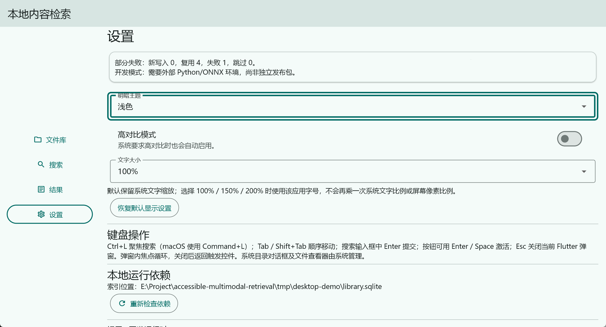

# 无障碍用户指南草稿

## 1. 开始使用前

本应用帮助你在本地文件中建立索引、输入文字查询、筛选结果并查看来源。当前主要可操作目标是 Windows 开发版本，支持 TXT、Markdown、PDF、DOCX、JPG 和 PNG。

**当前不是可直接分发的独立安装包。** 首次使用请让维护者按附录配置本地模型、Python/ONNX、Java/Tika 和完整 Release 目录。若启动后提示运行依赖未就绪，进入“设置”查看原因，依赖修复前不要反复建库。

本指南描述当前界面和已实现的操作方式。NVDA 完整实机朗读及 macOS/VoiceOver、Linux 体验尚未验收，不能保证所有辅助技术与系统窗口行为完全一致。验证范围见 [无障碍合规验证报告](无障碍合规验证报告.md)。

## 2. 认识四个功能区

| 功能区 | 你可以做什么 |
|---|---|
| 文件库 | 选择目录、建立或更新索引、查看文件处理状态、取消任务和清空索引 |
| 搜索 | 输入关键词或自然语言描述，设置文件类型、相对路径和修改日期条件 |
| 结果 | 查看本次条件、结果片段及出处，或请求系统打开原文件 |
| 设置 | 选择主题、高对比、文字大小，恢复默认并查看运行依赖 |

宽窗口中可在侧边导航切换；窗口变窄时导航布局可能改变。内容超出可见区域时可向下滚动，键盘使用者继续按 Tab 寻找操作控件。

## 3. 键盘操作速查

| 按键 | 用法 |
|---|---|
| Tab | 移动到下一个可操作控件 |
| Shift+Tab | 返回上一个可操作控件 |
| Enter | 在查询输入框提交搜索；在按钮上执行操作 |
| Space | 激活支持该操作的按钮或开关；不要在查询文本中把它当作提交键 |
| 方向键、Enter | 在展开的下拉选项中移动并确认 |
| Esc | 关闭当前 Flutter 弹窗／弹出层；系统窗口按系统自身规则处理 |
| Ctrl+L | Windows/Linux 当前实现中进入搜索并聚焦查询输入；有模态弹窗时先关闭弹窗 |
| Command+L | macOS 实现预留的对应快捷键，尚无该平台实机验收 |

焦点通常以控件外边框突出显示。焦点表示键盘下一次操作的对象，和鼠标悬停不同。若不确定当前焦点，按一次 Tab 并观察或听取控件信息；需要返回时用 Shift+Tab，不要直接盲按确认操作。

原生目录选择窗口和系统文件查看器由 Windows 管理，其快捷键、焦点顺序和返回位置可能与应用内页面不同。

## 4. 第一次建立文件库

1. 准备一个有读取权限的本地文件夹，保留原文件。演示或测试时使用单独样本目录。
2. 进入“文件库”，通过 Tab 找到“选择目录”，按 Enter，在系统窗口中选择文件夹并确认。也可以在“目录的绝对路径”输入完整路径。
3. 检查返回的目录，找到“建立 / 增量更新索引”并执行。
4. 等待处理完成。界面会显示阶段、处理数量以及成功、失败、复用等状态；模型首次加载可能需要更久。
5. 查看“本次文件状态”。“部分失败”表示部分文件未成功处理，不表示所有文件都没有入库；阅读失败原因后修复相应文件再更新。

同一内容可能共用索引文档，因此文件数、目录数与索引文档数不一定相等。

### 4.1 更新与取消

文件新增或修改后，对同一目录再次执行“建立 / 增量更新索引”，也可使用已添加目录卡片中的增量重建入口。未改变的内容会复用，修改后的内容重新处理。

如需停止，执行“取消索引任务”，等待安全点结束。取消不会回滚已经提交的索引；恢复时对同一目录重新更新即可。不要把关闭窗口或强制结束进程当作取消按钮。

文件删除或改名后，旧索引可能继续存在，增量更新不保证自动清理旧记录。确需彻底重建时，先确认当前应用索引的范围，再按第 9 节清空并重新添加目录。

## 5. 搜索与筛选

1. 进入“搜索”，或按 Ctrl+L。
2. 在“搜索本地内容”输入非空关键词或自然语言描述，例如你资料中出现的 `离线检索`。
3. 第一次先保留“所有类型”，路径和日期留空，按 Enter 或执行“开始搜索”。
4. 等待进入结果页面，检查“本次查询”和已应用条件。
5. 调整条件时，选择“修改搜索条件”返回表单；修改后需要再次提交。

| 筛选项 | 示例与规则 |
|---|---|
| 文件类型 | 可选择 TXT、Markdown、PDF、DOCX、图片或所有类型 |
| 相对目录或文件路径 | `notes/` 筛选导入目录内的子树，`notes/guide.txt` 指定文件；这里不要填盘符绝对路径 |
| 修改时间晚于日期 | 使用 `YYYY-MM-DD`，例如 `2026-10-25`；表示晚于该日期本地时间零点 |
| 清除筛选 | 清除筛选表单，之后仍需重新提交；不会自动把当前结果替换成无筛选结果 |

路径中的 `%` 和 `_` 按实际字符理解。日期应真实存在，例如 `2026-02-30` 无效。使用多个筛选条件会同时限制结果，条件过多时可逐个清除后重试。

搜索期间需要停止时，执行“取消当前搜索”，等待提示后再提交新查询。文件库任务进行中，请等待其结束或取消后再检索。

## 6. 阅读结果与打开来源

结果页显示本次查询、实际条件、文件名、片段和来源路径。每次最多显示前 20 条结果；排序代表检索相关性，分值不是正确概率。

- PDF 结果可以显示实际页码；TXT 等没有物理页码的格式不会生成假页码。
- 字符偏移使用 UTF-16 命中块跨度；片段可能带相邻上下文，不代表整段都是命中内容。
- 图片结果目前提供真实文件名、格式和尺寸等元数据，不提供完整的图像内容理解或描述。
- 找到相应结果的“打开原文件”按钮并激活，应用会请求系统使用对应查看器打开完整本地路径。

“已请求系统打开”只表示已提交打开请求。请确认系统查看器实际显示的是正确文件；有些系统会先让你选择打开方式。应用不保证自动跳到指定页或高亮指定片段。

返回检索程序时，使用系统的窗口切换方式。焦点返回的精确位置取决于系统与查看器，当前尚未完成所有组合的验收。索引更新或清空后，旧搜索结果会失效，请重新查询。

## 7. 调整外观和文字大小

进入“设置”，可用 Tab 找到选项，打开下拉框后用方向键选择并按 Enter 确认。

| 设置 | 选择与效果 |
|---|---|
| 明暗主题 | 跟随系统、浅色、深色 |
| 高对比模式 | 手动开启以增强文字、控件边界和主要操作的区分；系统高对比信号是否到达应用仍取决于平台 |
| 文字大小 | 跟随系统、100%、150%、200%；默认跟随系统文字缩放 |
| 恢复默认显示设置 | 恢复主题、字号跟随系统及手动高对比关闭；不清除文件索引 |

显式选择 100%／150%／200% 时，应用不会再额外乘一次系统文字比例或屏幕像素比例。字号较大时可滚动寻找下方控件，不需要为了读全内容而降低 Windows 系统缩放。

显示设置保存在当前应用数据目录中，正常重启同一数据目录时会恢复。若提示保存失败，本次画面可能已改变，但下次启动不一定能恢复；先记录提示并联系维护者。系统主动要求高对比且信号可用时，即使手动开关关闭，应用也可能使用高对比外观。



图 G4-1：在设置页选择主题、高对比和文字大小。截图中的目录路径为演示环境路径，你的电脑可以不同。

## 8. 配合读屏软件使用

在 Windows 上先按你平时的方式启动 NVDA，再进入应用，尝试用 Tab／Shift+Tab、Enter 和方向键完成上述操作。应用已配置控件名称、标题和动态状态语义；实际效果仍需在你所用的 NVDA 版本上确认。

输入前先确认读到的是目标字段，例如“搜索本地内容”或“相对目录或文件路径”。完成操作后留意加载、完成、取消和错误提示；当前进度语义按阶段或约 10% 区间更新，预期不会逐文件播报，但尚未验证实际语音是否重复或遗漏。

如果焦点或提示无法感知，不要凭猜测确认清空等操作。先返回上一个可辨认控件，必要时请熟悉软件的人协助，并把发生位置、实际按键和听到的内容反馈给维护者。

macOS／VoiceOver、Linux 暂无完成的实机操作承诺。本文不提供未经验证的特定读屏快捷键组合。

## 9. 清除索引与退出

“清除全部索引”会清除当前应用数据目录中的全部索引与已保存目录记录，**不是只清除输入框所指向的某个目录**。所有源文件保留；清空后需要重新添加目录建库。

1. 先确认当前索引范围和显示的索引位置。
2. 执行“清除全部索引”，阅读弹窗说明。
3. 默认操作为“保留索引”。不想清空时按 Esc 或选择保留。
4. 只有确实要清空当前整个索引时，才选择“确认清除索引”。

正常退出使用应用窗口的关闭按钮或系统关闭窗口操作。若后台任务正在结束，请等待当前安全点，不要反复启动写入同一数据目录的多个实例。

## 10. 常见问题与恢复

| 提示／现象 | 处理方法 |
|---|---|
| 运行依赖尚未就绪 | 进入“设置”查看具体阻塞项；由维护者配置后执行“重新检查依赖” |
| 某个 DOCX 不是有效 ZIP 容器 | 确认文件没有损坏且确实是 DOCX，不是仅改扩展名的文本；修复或移出测试文件再更新 |
| 索引库为空 | 先添加目录并完成建库，再重新搜索 |
| 当前条件下没有检索结果 | 检查本次条件，清除类型、路径或日期限制并重新提交；不等于已确认所有资料都没有答案 |
| 日期不存在／路径格式错误 | 按字段说明修正；日期用真实年月日，路径筛选使用相对路径 |
| 源文件不存在或不可访问 | 恢复原路径、确认读取权限后重试；必要时重建当前专用索引以移除旧记录 |
| 系统未能打开文件 | 确认原文件、权限及系统查看器可用；可复制来源路径手动打开，再向维护者反馈 |
| 字体变大后下方按钮不见 | 向下滚动或继续 Tab；若控件仍无法到达，记录页面、字号、窗口尺寸并反馈 |
| 显示设置损坏／保存失败 | 保留错误信息；尝试“恢复默认显示设置”，仍失败时请维护者检查应用数据目录权限 |

当前功能在本地进行索引与检索，但 Week 5 的完整 UI 断网流程尚无隔离环境实测记录，不以此指南宣称离线验收已经全部完成。

## 11. 反馈问题时提供什么

请记录：所在页面、输入或操作、实际结果、期望结果、系统与读屏版本、主题／字号／系统缩放，以及能否重复发生。若附截图或日志，先检查是否包含私人文件名、查询和内容；不需要提供无关的完整文件库。

维护者将问题登记到 [问题与复测记录](E_问题与复测记录.md)，修复后在相同平台与显示／读屏条件复测。

## 附录：维护者启动与数据位置

以下是现有开发环境的启动方式，不是面向最终用户的安装流程。先确认仓库环境、模型、Java/Tika 和 Windows Release 构建均已准备好；保留 DLL 与 `data` 等完整目录。

在仓库根目录 PowerShell 中执行：

```powershell
$env:AMR_DEV_ROOT = (Get-Location).Path
$env:AMR_DATA_DIR = Join-Path $env:AMR_DEV_ROOT 'tmp/desktop-demo'
& './apps/desktop/build/windows/x64/runner/Release/desktop.exe'
```

演示目录可替换为自己的**绝对路径**；与截图示例或评测库分开。再次启动时保持相同 `AMR_DATA_DIR` 才能使用原有索引和显示设置，不要每次自动更换数据目录。此操作不会自动创建测试输入文件。

| 配置／文件 | 含义 |
|---|---|
| `AMR_DEV_ROOT` | 开发资源所在仓库绝对路径；当前生产推理适配器未接通，无此配置不能视为可运行的正式发布包 |
| `AMR_DATA_DIR` | 可选应用数据目录的绝对路径；未设置时 Windows 默认使用 `%LOCALAPPDATA%/AccessibleMultimodalRetrieval` |
| `AMR_JAVA` | Java 可执行文件绝对路径；未指定时从 PATH 使用 `java` |
| `library.sqlite` | 所选数据目录中的索引数据库，源文件不保存在该数据库中作为可编辑原件 |
| `display-settings.json` | 同一数据目录中的显示设置 |

不要将 `reports/week5/.index/bench.sqlite` 当作演示索引，不直接编辑正在使用的数据库。正式安装、模型分发、macOS/Linux 和生产运行时方案仍属于后续完善范围。
